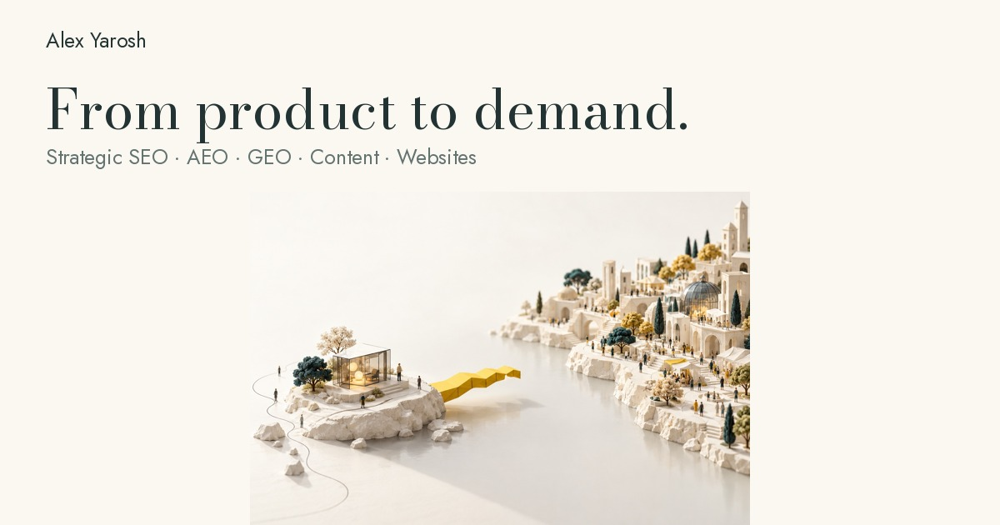
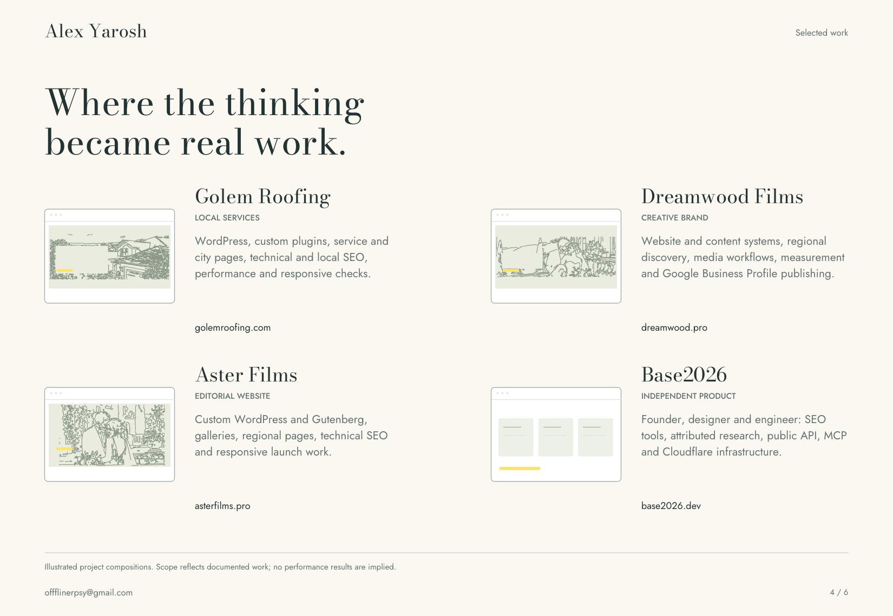

# Alex Yarosh

**Strategic SEO · AEO · GEO · Content · Website development**

You can build a product in a weekend. Knowing whether people need it, how they will find it and what deserves your next investment takes a different kind of work.

I help founders and businesses investigate those questions, make sense of what is holding them back, and turn a useful direction into a website, content and search strategy they can put into practice.

[Explore my portfolio](https://base2026.dev/alex-yarosh/) · [View the PDF](https://base2026.dev/alex-yarosh/assets/Alex_Yarosh_Fieldwork.pdf) · [Let's talk](mailto:offflinerpsy@gmail.com)

## A clearer next move

| Understand the opportunity | Build the foundations | Keep improving |
| --- | --- | --- |
| Demand and competitor research. Product and website audits. Audience, offer and positioning. Priorities worth testing. | Technical and local SEO. AEO and GEO. WordPress, modern CMS platforms, custom websites and landing pages. | Article writing. Blog management. Content updates. Search Console, analytics and practical iteration. |

SEO, content and website development are core parts of my practice. I can help decide what should change, then write, build, publish and check the work.

## Selected work

### [Golem Roofing](https://golemroofing.com/)

A stronger technical foundation for a local service business. WordPress and Elementor implementation, custom plugins, service and city page patterns, technical SEO, local discovery and responsive performance checks.

### [Dreamwood Films](https://dreamwood.pro/)

Website and publishing systems for a visual brand. Regional and venue content, portfolio and media workflows, measurement, and Google Business Profile publishing.

### [Aster Films](https://asterfilms.pro/)

Custom WordPress and Gutenberg delivery for an editorial photography and film website. Galleries, wedding stories, regional discovery pages, media integration and launch checks.

### [Base2026](https://base2026.dev/)

My independent research product. I work across product direction, design, engineering and search: attributed practitioner research, practical tools, public API and MCP access, and Cloudflare infrastructure.

## The person behind the work

**25+ years in technology and the web. More than 2,000 websites created.**

I learned by building, publishing, testing and improving real websites. That experience helps me connect the business question with the technical and editorial work needed to answer it.

My work has previously earned **Top Rated recognition on Upwork**. Today I combine strategic analysis with hands on delivery and take responsibility for the scope, priorities, quality and handoff.

I use AI for research, drafting, coding and agent workflows, with review and testing throughout. I can lead the technical work, coordinate contributors and keep communication clear through tools such as Slack and ClickUp.

 

## Let's work out what comes next

Have a product, website or idea that needs a clearer direction? Send a little context and a link if you have one. We can start by identifying what needs attention and agreeing a focused scope.

**[offflinerpsy@gmail.com](mailto:offflinerpsy@gmail.com)**

[Portfolio](https://base2026.dev/alex-yarosh/) · [LinkedIn](https://www.linkedin.com/in/alex-yarosh-a21842227/) · [X](https://x.com/AleksejAros) · [GitHub](https://github.com/offflinerpsy)
